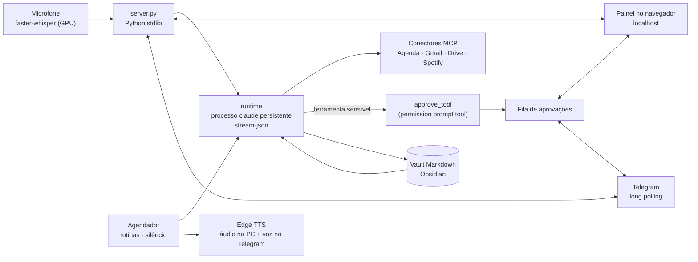

# Claudio: assistente pessoal com voz, memória e Telegram

**Agente pessoal que roda no meu PC, usa o Claude Code como cérebro, lembra de tudo numa pasta de notas Markdown (Obsidian) e fala comigo por voz no computador e pelo Telegram no celular.**

Uso o Claudio todo dia:
- Às 7h30 de dias úteis, ele monta o briefing do dia: lê minha agenda do Google e minhas notas e me fala as aulas, os compromissos e as três tarefas mais importantes.
- Durante o dia, peço coisas por voz ou pelo Telegram.
- Quando ele precisa fazer algo sensível no PC, pede aprovação antes.

## O que ele faz

| | |
|---|---|
| **Voz** | Fala com voz neural (Edge TTS) e escuta pelo microfone com transcrição local na GPU (faster-whisper). |
| **Memória** | Um "segundo cérebro" em Markdown: perfil, objetivos, uma nota por projeto e um diário. As notas relevantes entram no contexto de cada pedido, e o próprio agente atualiza o diário e as notas ao terminar uma tarefa. |
| **Telegram** | Mesmo cérebro e mesma memória no celular. Recebe texto e áudio, responde com texto e voz, e só atende o meu chat. |
| **Rotinas** | Briefing diário, lembretes ("me lembra às 15h de...") e rotinas semanais, que o agente cria editando o próprio `rotinas.json`. |
| **Modo prova** | "Tenho prova até as 12h" silencia todos os avisos em todos os canais até a hora marcada. |
| **Aprovação humana** | Ferramentas sensíveis passam por um cartão Aprovar/Negar, que aparece na tela do PC e no Telegram ao mesmo tempo. Leituras (agenda, e-mail, arquivos) são liberadas; comandos no PC e edição de arquivos esperam a minha decisão. |
| **Integrações** | Google Agenda, Gmail, Drive e Spotify pelos conectores MCP do Claude. |

## Arquitetura

**Decisões que tomei:**
- **O Claude Code CLI como cérebro**, em processo persistente (cerca de 2,5 s por resposta). Ele herda as ferramentas, os conectores MCP e a assinatura que já uso, sem chave de API à parte.
- **Aprovação fora do modelo.** O `approve_tool.py` é registrado como *permission prompt tool* do Claude Code. O modelo não consegue pular a aprovação, porque quem decide é o servidor, por uma fila que atende o PC e o celular ao mesmo tempo.
- **Memória legível por humanos.** Tudo é Markdown com frontmatter, que eu abro e edito no Obsidian. O `vault_check.py` valida a estrutura das notas.
- **Zero dependência pesada.** Servidor, Telegram e agendador usam só a biblioteca padrão do Python (`http.server`, `urllib`, `threading`). As únicas dependências pip são as de voz.
- **Só localhost.** Nada fica hospedado. O Telegram usa long polling, então não precisa abrir porta.

## O que está neste repositório

O Claudio foi construído a partir do projeto open source [jarvis-claude-code](https://github.com/Itsme23476/jarvis-claude-code), que fornece o painel, o loop com o Claude Code e a voz. Como esse projeto não tem licença declarada, publico aqui **só os módulos que escrevi do zero**:

| Arquivo | O que faz |
|---|---|
| [`src/telegram.py`](src/telegram.py) | Bot do Telegram com texto, áudio e botões de aprovação, restrito a um chat |
| [`src/scheduler.py`](src/scheduler.py) | Rotinas recorrentes e únicas, modo silêncio e avisos por voz no PC e no Telegram |
| [`src/approvals.py`](src/approvals.py) | Fila de aprovações compartilhada entre a tela e o celular |
| [`src/approve_tool.py`](src/approve_tool.py) | Ponte entre o Claude Code e a fila (permission prompt tool via MCP) |
| [`src/vault_check.py`](src/vault_check.py) | Validador da estrutura do vault |

Também adaptei a base: a memória passou a ler o vault do Obsidian e a injetar só as notas relevantes, o runtime ganhou processo persistente e uma lista de ferramentas liberadas sem aprovação, a voz ganhou transcrição local em português e o painel foi redesenhado. Essas mudanças ficam no repositório privado.

## Stack

Python (biblioteca padrão) · Claude Code CLI (stream-json, permission prompt tool, MCP) · Edge TTS · faster-whisper (CUDA) · Telegram Bot API · Obsidian · JavaScript

## Planejamento

Projetado com spec e plano escritos antes de cada fase. As cinco fases foram concluídas em setembro de 2026:
1. vault;
2. painel;
3. servidor e voz;
4. Telegram;
5. rotinas e música.

---

© 2026 Guilherme Reis Nahass. Arquivos em `src/` sob licença MIT.
